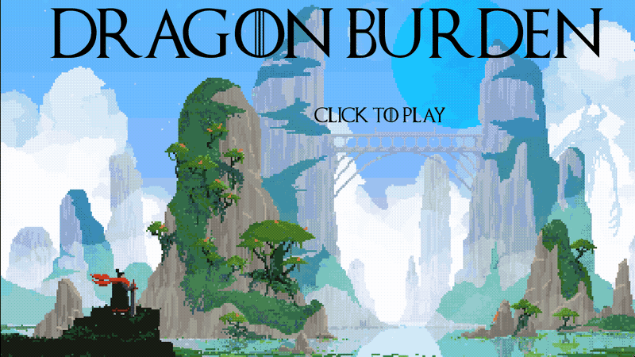
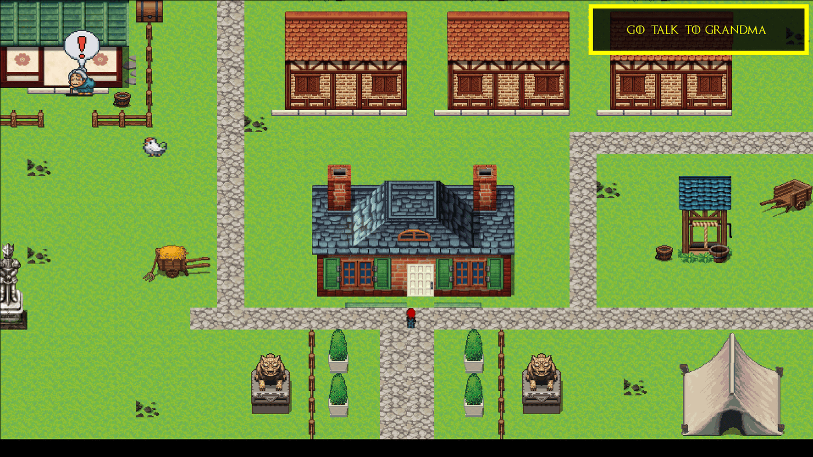
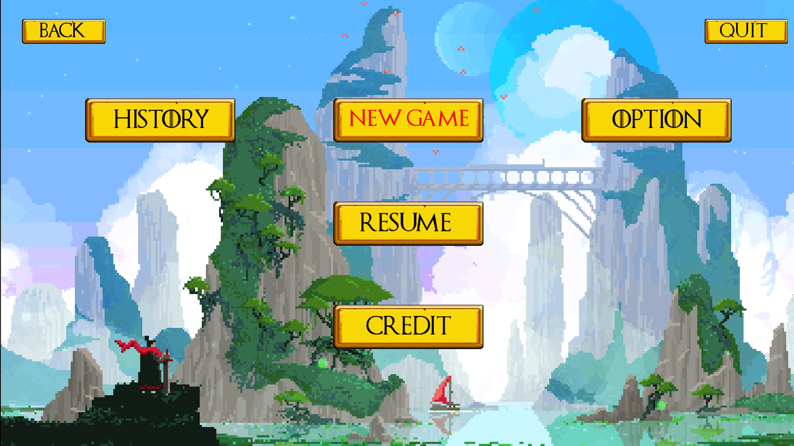

<div align="center">

# Dragon Burden

**Un RPG 2D en pixel art, écrit en C de A à Z.**

  

<sub>Projet à 4 · 2023</sub>

</div>

<br/>

<p align="center"></p>

## En deux mots

Notre premier gros jeu : un RPG complet en C avec la CSFML, fait à quatre en un mois. Un village à explorer, une grand-mère qui donne la première quête, des combats au tour par tour avec des sorts, un inventaire, et toutes les options qu'on attend d'un vrai jeu.

## Ce que ça fait

- Exploration d'un village et de plusieurs cartes, avec collisions
- **Quêtes** et dialogues avec les personnages
- **Combats** avec sorts, attaques ennemies et fin de combat
- **Inventaire** en glisser-déposer : équiper un objet change l'attaque et la défense
- Menu principal, histoire, crédits, sauvegarde et chargement
- Options : volume de la musique et des effets, résolution, FPS

<p align="center"></p>
<p align="center"><sub>Le village et la première quête</sub></p>

<p align="center"></p>
<p align="center"><sub>Le menu principal</sub></p>

## Sous le capot

Tout l'état du jeu tient dans une structure globale découpée par module (fenêtre, menus, cartes, inventaire, combat…). Chaque scène a ses fonctions d'init, d'events, d'update et de destroy, et la boucle principale aiguille selon la scène active.

## Lancer le projet

```bash
make
./my_rpg
# flèches pour se déplacer, la souris pour les menus et l'inventaire
```

## L'équipe

<a href="https://github.com/Wilson-Epitech/my_rpg/graphs/contributors"></a>

Eva Legrand, Yanis Harkouk, Wilson Bordichon, Amytis Vaea

**Ma part :** J'ai monté la **structure globale** du jeu et la gestion de la fenêtre, l'**inventaire** complet (affichage, glisser-déposer, double-clic pour utiliser un objet, effets sur les stats), le **menu principal** et les **options**, le déplacement et l'animation du personnage, et l'aide des quêtes.
